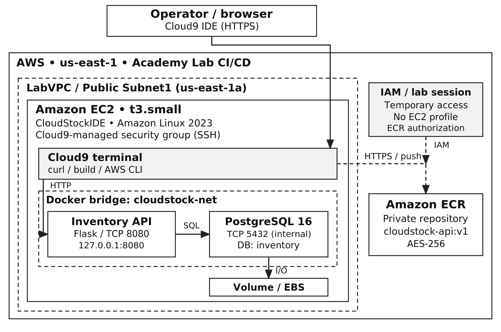

# CloudStock

CloudStock adalah REST API sederhana untuk pengelolaan inventaris barang. Aplikasi menggunakan Flask dan PostgreSQL, dijalankan dalam dua container Docker pada satu EC2. Docker image API disimpan pada private repository Amazon ECR.

**Cloud Computing — Week 12, Track B (Containers)**  
Nabila Putri Barokah · 24/541890/TK/60132 · Teknologi Informasi

## Arsitektur



Operator mengirim HTTP request melalui terminal EC2 ke API pada `127.0.0.1:8080`. API terhubung ke PostgreSQL melalui bridge network `cloudstock-net`. Database menggunakan volume `cloudstock-data` untuk menyimpan data secara persisten. Port 5432 tidak dipublikasikan ke host. ECR menyimpan image `cloudstock-api:v1`.

## Entitas dan API

Entitas `Item` memiliki atribut `id` (integer, primary key otomatis), `name` (varchar 100), `quantity` (integer nonnegatif), dan `location` (varchar 100).

| Method | Endpoint | Fungsi |
| --- | --- | --- |
| POST | `/items` | Menambah barang |
| GET | `/items` | Menampilkan daftar barang |
| PUT | `/items/{id}` | Memperbarui barang |
| DELETE | `/items/{id}` | Menghapus barang |
| GET | `/health` | Memeriksa koneksi database dengan SELECT 1 |

Contoh request JSON:

```json
{"name":"Keyboard","quantity":10,"location":"Rak A"}
```

## Lingkungan implementasi aktual

| Komponen | Konfigurasi |
| --- | --- |
| Lab | AWS Academy Lab CI/CD (bukan Learner Lab) |
| Region | us-east-1 (N. Virginia) |
| Development environment | Cloud9: CloudStockIDE |
| EC2 | t3.small, Amazon Linux 2023 |
| Network | LabVPC, Public Subnet1, us-east-1a |
| IAM | Tidak ada instance profile; AWS CLI menggunakan akses sesi lab |
| Security | Security group Cloud9, koneksi SSH, API loopback |
| Docker | 25.0.14 |
| ECR | Private cloudstock-api, mutable, AES-256 |

Akses AWS Learner Lab belum tersedia. Percobaan membuat EC2 secara langsung gagal karena `ec2:RunInstances` tidak diizinkan. Cloud9 kemudian berhasil membuat EC2 melalui fasilitas development environment yang tersedia pada Lab CI/CD. Persetujuan dosen untuk penggunaan lab alternatif belum terdokumentasi. Konfigurasi aktual berbeda dari rencana awal t3.micro.

## Rencana deployment dan reproduksi

Prasyarat: Docker, Bash, Python 3, curl, OpenSSL, AWS CLI, serta akses AWS yang diizinkan. Jika menggunakan Learner Lab, pilih satu EC2 Linux yang diizinkan, misalnya t3.micro dengan EBS 8 GiB gp3. Gunakan IAM role dan jaringan yang disediakan lab. Untuk implementasi aktual, Cloud9 telah menyediakan Docker sehingga tidak perlu instalasi tambahan.

Salin file proyek ke direktori kerja (atau jalankan `CloudStock_Setup_EC2.txt` melalui Bash pada EC2). Jalankan:

```sh
cd ~/cloudstock
bash deploy.sh
sudo docker images
sudo docker ps
curl -fsS http://127.0.0.1:8080/health
bash test-api.sh
```

`deploy.sh` membangun image API, membuat network dan volume, menghasilkan password database dalam `.env`, menjalankan PostgreSQL serta API, kemudian menunggu health check. Jangan membuka port 8080 atau 5432 ke internet. API belum memiliki autentikasi aplikasi dan hanya ditujukan untuk pengujian lokal pada host.

Untuk menyimpan image, buat satu private ECR repository `cloudstock-api` pada region yang sama, kemudian jalankan dengan izin ECR yang sesuai:

```sh
bash push-ecr.sh us-east-1
```

Script menggunakan AWS CLI untuk login, tag, push, dan memeriksa image digest. Jangan menyimpan akses AWS sementara, file PEM, `.env`, atau token Docker di repository.

### Pengujian lokal pada Windows

Docker image dibangun menggunakan `docker build -t cloudstock-api:v1 .`. PostgreSQL dan API dijalankan pada network yang sama. Karena port host 8080 tidak tersedia, pengujian Windows menggunakan `127.0.0.1:18080` yang dipetakan ke port internal 8080. Pengujian AWS tetap menggunakan port host 8080.

## Hasil pengujian — 26 November 2026

| Pengujian | Hasil |
| --- | --- |
| Local image build | Berhasil |
| Local health check dan CRUD | Berhasil |
| EC2 melalui Cloud9 | Running; status checks 3/3 passed |
| AWS Docker build | cloudstock-api:v1 (147 MB) |
| AWS containers | cloudstock-api dan cloudstock-db, status Up |
| AWS health check | database connected, status ok |
| AWS CRUD | POST, GET, PUT terlihat berhasil; GET setelah DELETE menghasilkan [] |
| ECR push dan verifikasi | Tag v1, ukuran 54,49 MB |
| Penghematan biaya | Permintaan stop EC2 berhasil; bukti terakhir Stopping |

Bukti asli (dipotong untuk keterbacaan dan sebagian informasi identitas disamarkan) tersedia di [AWS_Evidence.pdf](evidence/AWS_Evidence.pdf). Respons DELETE di AWS terpotong, tetapi GET setelah penghapusan menunjukkan daftar kosong. Rincian inbound rules dan status akhir Stopped belum terdokumentasi. Saldo terakhir yang dilaporkan sebelum deployment adalah $34,10 dari $40; saldo akhir belum diketahui.

Setelah pengujian, tutup IDE dan hentikan instance CloudStock. Jangan menghapus resource bawaan lab. EBS dan ECR tetap dapat dikenakan biaya penyimpanan.

## Struktur proyek

- `app.py`, `requirements.txt`: backend REST API dan dependensi.
- `Dockerfile`, `.dockerignore`: konfigurasi build image.
- `deploy.sh`, `test-api.sh`, `push-ecr.sh`: deployment, pengujian, dan upload ECR.
- `Design_Brief.pdf`, `Architecture.pdf`, `Architecture.png`, `Architecture.svg`: dokumen rancangan.
- `evidence/`: laporan dan screenshot pengujian.

## Repository GitHub

[https://github.com/nabilaputribarokah01/CloudStock](https://github.com/nabilaputribarokah01/CloudStock) — repository private, branch `main`. Screenshot menunjukkan initial commit dan README awal. Publikasi source code dan riwayat commit lokal belum terverifikasi. Pastikan dosen/asisten mendapat akses untuk penilaian.
